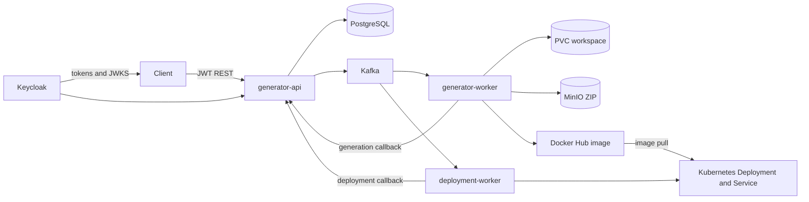

# Current architecture

`generator-api` owns lifecycle state. Generation never implies deployment. Each worker consumes cleanup in its own consumer group: generator-worker removes assets, deployment-worker removes owned Kubernetes resources.

Infrastructure namespaces: `scaffoldops` for PostgreSQL, `security` for Keycloak, `scaffoldops-dev` for Kafka/MinIO/applications. Supplied deployment RBAC targets `generated-dev`. The current manifests have [configuration gaps](../findings.md); this diagram shows responsibilities rather than certifying a working installation.

[Lifecycle sequences](../lifecycles.md) · [Platform overview](../../architecture.md)
