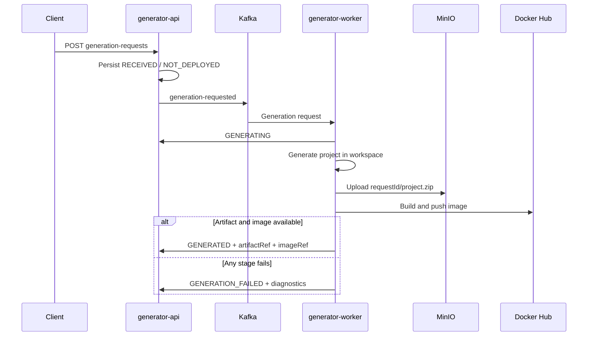
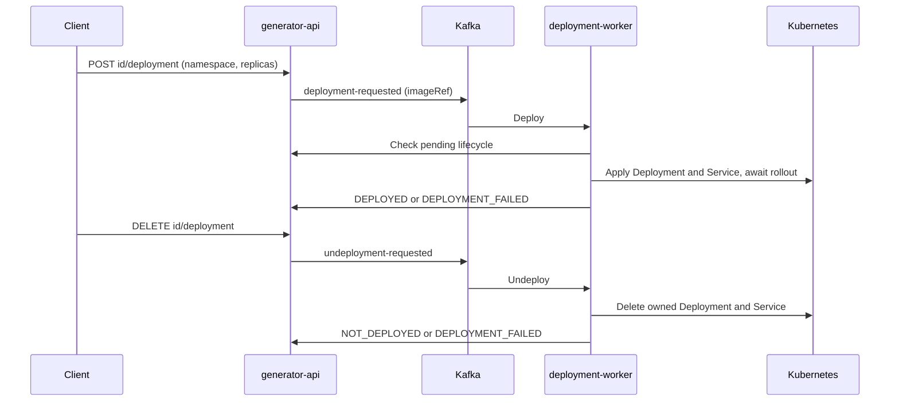

# Lifecycle and Kafka contracts

## Generation and artifact/image lifecycle

REST reports `generation.status`; callbacks/events use `generationStatus`. Creation sets `RECEIVED` and `deployment.status=NOT_DEPLOYED`. The worker reports `GENERATING`, writes the selected request's Spring Boot project, publishes the artifact and builds/pushes the image. `GENERATED` requires nonblank `artifactRef` and `imageRef`; incomplete completion callbacks are rejected with HTTP 422.



MinIO artifact reference: `s3://scaffoldops-artifacts/<requestId>/project.zip`; ZIP project files are at archive root. Legacy/filesystem references use `file://` workspace paths. Default generated image: `docker.io/victodomvar/scaffoldops-generated:<serviceName>-<requestId>` with normalized service name. Manifest records intended image reference; that alone does not prove push succeeded.

Image failures after upload preserve `artifactRef`, clear `imageRef` and record `message`, `failureStage` (`IMAGE_BUILD` or `IMAGE_PUSH`) and `retryCount`. Worker image attempts default to 3 with 1000 ms backoff; Kafka generation error handling adds two retries before `generation-requested-dlt` (invalid arguments are not retried). These are separate retry mechanisms.

Recovery is an API scheduler, not a public endpoint. Default delay 5m, maximum cumulative retries 5, batch size 10 and reservation timeout 30m. Only failed rows with an artifact, no image and eligible image failure stage qualify. PostgreSQL `FOR UPDATE SKIP LOCKED` reserves requests; `image-build-retry-requested` sends artifact metadata and retry attempt to the worker, which reuses workspace or recovers the ZIP. Callbacks clear reservations; expired reservations allow later attempts. Publication failure consumes an attempt. Recovery does not deploy anything.

## Deployment and undeployment

Deploy requires completed generation with both references and a valid target namespace/replica count (1–20). API sets `DEPLOYING` and publishes the generated `imageRef`; the worker checks pending state/namespace, applies owned Deployment and ClusterIP Service and waits up to 120 seconds for rollout. It reports `DEPLOYED` or `DEPLOYMENT_FAILED`. TCP readiness defaults to port 8080.



Undeploy is a lifecycle operation: it preserves the request, MinIO artifact, image and namespace for redeployment. It is accepted from `DEPLOYED` or `DEPLOYMENT_FAILED` with known namespace; duplicate/invalid transitions return 409. Cancellation while deploying is unsupported. Legacy requested statuses remain readable but new operations use `DEPLOYING` and `UNDEPLOYING` directly.

Resource names combine a sanitized 30-character name prefix and full UUID without dashes. Ownership labels are `app.kubernetes.io/managed-by=scaffoldops` and `scaffoldops.io/request-id`. The worker refuses conflicting owners and deletes only owned resources. Missing resources succeed. Invalid messages are discarded; operational/API transport failures retry indefinitely, while Kubernetes failures produce a failed lifecycle. Deleted/superseded requests are skipped; callback 404/409 is acknowledged.

## Permanent delete

```mermaid
sequenceDiagram
    participant Client
    participant API as generator-api
    participant DB as PostgreSQL
    participant Kafka
    participant G as generator-worker
    participant D as deployment-worker
    Client->>API: DELETE generation-requests/id
    API->>DB: Lock request and delete row in transaction
    API->>Kafka: artifact-cleanup-requested, await acknowledgement
    API->>DB: Commit
    API-->>Client: 204 accepted
    Kafka->>G: requestId, name, artifactRef, imageRef
    G->>G: Remove workspace, MinIO object, supported Docker Hub tag
    Kafka->>D: requestId, name, deploymentNamespace
    D->>D: Remove owned Kubernetes resources; no callback
```

Delete is destructive cleanup, unlike undeploy. API removes DB state; generator-worker independently attempts PVC workspace removal, safe legacy file cleanup, exact MinIO object (or explicit trailing-slash prefix) and optional Docker Hub tag cleanup. It does not delete the shared PVC itself. Docker Hub cleanup defaults off and requires explicit application property enablement plus credentials with delete permission. Only explicit Docker Hub repository/tag references are supported; digest-only/other-registry references are skipped. See the [configuration finding](findings.md) about the environment override.

External generator cleanup is best-effort: failures warn without failing the entire event; there is no durable cleanup result or automatic external retry. Deployment-worker receives the same topic in its own group and skips cleanup without a namespace. HTTP 204 does not prove assets are gone; 404 means the row was absent.

API delete and deployment publication wait for Kafka acknowledgement inside DB transactions, but PostgreSQL and Kafka are not atomic. Late sends, commit failures and crashes can leave inconsistent state; no outbox exists. Deleting during active generation can race with later asset creation. Reconcile assets/resources from retained cleanup events.

## Topics

| Topic | Producer → consumer |
| --- | --- |
| `generation-requested` | API → generator-worker |
| `image-build-retry-requested` | API scheduler → generator-worker |
| `generation-requested-dlt` | generator-worker error handler → operator inspection |
| `deployment-requested` | API → deployment-worker |
| `undeployment-requested` | API → deployment-worker |
| `artifact-cleanup-requested` | API → both workers, separate groups |

Generation/cleanup events use `requestId`; deployment/recovery use `generationRequestId`. Generation includes `name`, `template`, feature flags, `deploymentTarget`, `generationStatus`, `createdAt`; worker accepts legacy `status`. Deployment includes `name`, `artifactRef`, `imageRef`, `namespace`, `replicas`, `requestedAt`; undeploy omits artifact/image/replicas. Cleanup includes optional references/`deploymentNamespace` and `deletedAt`. Artifacts are not carried in Kafka. Consumer groups are `generator-worker` (configurable) and `deployment-worker`.
